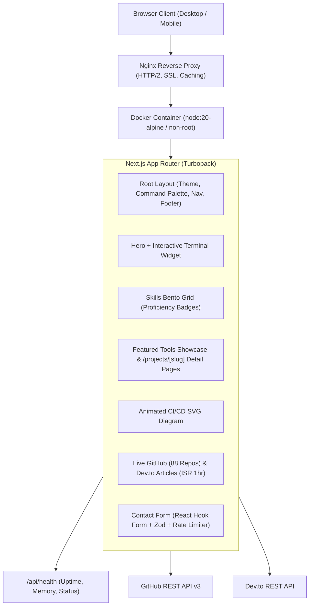

# 🛡️ Shuvo Halder — DevOps & Systems Engineer Portfolio

> **Production-grade, high-reliability personal portfolio engineered with Next.js 16 (App Router), TypeScript (Strict), Tailwind CSS v4, and an Infrastructure Control Room design system.**

[](https://github.com/shuvo-halder/portfolio-next/actions)
[](https://nextjs.org/)
[](https://www.typescriptlang.org/)
[](Dockerfile)
[](LICENSE)
[](https://shuvohalder.dev)

---

## 📋 System Overview

This portfolio website is designed specifically for **DevOps Engineers, Systems Engineers, and Linux Administrators**. Rather than a static marketing template, the repository itself demonstrates production engineering rigor:

* **Interactive Terminal Widget:** Real command parser with command history (`whoami`, `ls`, `cat skills.txt`, `uptime`, `status`, `contact`).
* **Interactive Command Palette (`⌘K` / `Ctrl+K`):** Global keyboard-driven quick navigator across all routes and actions.
* **Animated CI/CD Pipeline:** Interactive SVG architecture diagram visualizing `Commit ➔ Build ➔ Test ➔ Scan ➔ Deploy ➔ Monitor`.
* **Live GitHub & Dev.to Integrations:** Real-time metrics fetched via GitHub REST API (88 repositories, stargazers, forks, language distribution) and Dev.to publications, with 1-hour Incremental Static Regeneration (ISR) and static snapshot fallbacks.
* **Production Hardening:** Multi-stage Alpine Dockerfile, non-root user (`UID 1001`), `/api/health` telemetry endpoint, and enterprise Nginx reverse proxy configuration.

---

## 🏛️ Architecture & Data Flow



---

## 🛠️ Tech Stack & Architecture Choices

| Component | Technology | Rationale |
| :--- | :--- | :--- |
| **Framework** | **Next.js 16 (App Router)** | Server Components, Partial Prerendering (PPR), dynamic OpenGraph generation, and built-in ISR. |
| **Language** | **TypeScript (Strict Mode)** | Complete type safety across all profile models, API responses, and form inputs. |
| **Styling** | **Tailwind CSS v4** | CSS variables-driven dark/light theme, custom grid utilities, and zero-runtime overhead. |
| **Icons** | **Lucide Icons + Custom SVGs** | Clean infrastructure iconography and pixel-perfect brand SVG primitives. |
| **Theme** | **next-themes** | Persistent dark-mode default with zero hydration flash. |
| **Forms & Validation** | **React Hook Form + Zod** | High performance client-side and server-side validation with automated honeypot spam protection. |
| **Testing** | **Vitest** | Sub-500ms unit test execution with zero external mocks. |
| **Containerization** | **Docker Multi-Stage (Alpine)** | Non-root container (`nextjs:nodejs`), standalone output, built-in healthchecks. |

---

## 📂 Repository Structure

```text
portfolio-next/
├── .github/
│   ├── dependabot.yml                 # Automated dependency updates
│   └── workflows/
│       ├── ci.yml                     # Lint, Type-check, Unit tests, Build
│       └── cd.yml                     # Docker build & GHCR publish
├── docker-compose.yml                 # Standalone app + Nginx reverse proxy
├── Dockerfile                         # Multi-stage production container
├── nginx.conf                         # Production Nginx reverse proxy & SSL config
├── vitest.config.mts                  # Unit test runner configuration
├── src/
│   ├── app/
│   │   ├── api/
│   │   │   ├── contact/route.ts       # Rate-limited contact dispatch handler
│   │   │   └── health/route.ts        # Telemetry healthcheck endpoint
│   │   ├── projects/[slug]/
│   │   │   ├── page.tsx               # Deep-dive architecture routes
│   │   │   └── not-found.tsx          # 404 handler for unknown projects
│   │   ├── globals.css                # Custom control room tokens & scanlines
│   │   ├── layout.tsx                 # Root layout with JSON-LD & Skip links
│   │   ├── opengraph-image.tsx        # Dynamic next/og social share banner
│   │   ├── page.tsx                   # Main single-page portfolio
│   │   ├── robots.ts                  # Dynamic robots.txt
│   │   └── sitemap.ts                 # Dynamic sitemap.xml
│   ├── components/
│   │   ├── layout/                    # Header, Footer, CommandPalette
│   │   ├── sections/                  # Hero, About, Skills, Projects, Github, etc.
│   │   ├── terminal/                  # InteractiveTerminal with bash commands
│   │   ├── ui/                        # CodeBlock, Icons, Badges
│   │   └── visualization/             # PipelineDiagram, Skeletons
│   ├── data/                          # Single source of truth content layer
│   │   ├── content.ts                 # Profile data & TODO placeholders
│   │   ├── github-fallback.ts         # Verified static GitHub telemetry
│   │   ├── projects.ts                # Deep technical specs for 6 featured tools
│   │   ├── skills.ts                  # Categorized skills matrix with proficiencies
│   │   └── timeline.ts                # Experience, education & GitHub achievements
│   ├── lib/
│   │   ├── devto.ts                   # Dev.to API client (with ISR)
│   │   ├── github.ts                  # GitHub REST API client (with ISR)
│   │   ├── rate-limit.ts              # In-memory sliding window rate limiter
│   │   └── utils.ts                   # Date formatters, uptime calculators, cn()
│   └── types/                         # TypeScript interfaces & types
└── tests/
    └── unit/                          # Vitest unit test suites
```

---

## 🚀 Quick Start & Development

### Prerequisites
* **Node.js**: v20 or higher
* **Package Manager**: `pnpm` (recommended)

```bash
# 1. Clone the repository
git clone https://github.com/shuvo-halder/portfolio-next.git
cd portfolio-next

# 2. Install dependencies
pnpm install

# 3. Configure environment variables (optional)
cp .env.example .env.local

# 4. Start development server
pnpm dev
```

Open `http://localhost:3000` in your browser.

### Test & Build Scripts
```bash
# Run ESLint validation
pnpm lint

# Run strict TypeScript type-checking
pnpm type-check

# Run Vitest unit tests
pnpm test

# Build production standalone bundle
pnpm build

# Start production server locally
pnpm start
```

---

## 🚢 Production Deployment

### Option A: Vercel (Zero-Config)
1. Import repository to Vercel.
2. Framework preset: **Next.js**.
3. Configure environment variables (e.g. `RESEND_API_KEY`, `GITHUB_TOKEN`).
4. Click **Deploy**. All ISR routes, Partial Prerendering, and dynamic OpenGraph images are handled automatically.

---

### Option B: Docker on a Linux VPS (Self-Hosted)
Run the application directly as a hardened, standalone container:

```bash
# 1. Build the multi-stage Docker container
docker build -t shuvo-portfolio:latest .

# 2. Run the container with resource limits and healthchecks
docker run -d \
  --name portfolio-app \
  --restart unless-stopped \
  -p 3000:3000 \
  -e NODE_ENV=production \
  shuvo-portfolio:latest

# 3. Verify health status
curl http://localhost:3000/api/health
```

---

### Option C: Docker Compose with Nginx & Let's Encrypt SSL
For production domains with SSL termination:

1. Copy `docker-compose.yml` and `nginx.conf` to your VPS.
2. Edit `nginx.conf` and replace `shuvohalder.dev` with your actual domain name.
3. Obtain SSL certificates using Certbot or Shuvo's [`certbot-smart-manager`](https://github.com/shuvo-halder/certbot-smart-manager):
   ```bash
   sudo certbot certonly --webroot -w /var/www/certbot -d yourdomain.com -d www.yourdomain.com
   ```
4. Start the stack:
   ```bash
   docker compose up -d
   ```
5. Check service telemetry:
   ```bash
   docker compose ps
   curl -I https://yourdomain.com
   ```

---

## ✏️ Content Editing & Personalization

All editable content is centralized in `src/data/` so no code inside components needs modification:

* **Profile & Socials:** Edit `src/data/content.ts` (`name`, `tagline`, `bio`, `socials`).
* **Skills Matrix:** Edit `src/data/skills.ts` (add new skills or update proficiency: `production`, `advanced`, `intermediate`, `planned`).
* **Featured Projects:** Edit `src/data/projects.ts` (add new repositories with problem, solution, and impact metrics).
* **Experience & Timeline:** Edit `src/data/timeline.ts` (update roles, education, and credentials).

### Personal Items to Fill In (Checklist)
1. **Resume File:** Place your PDF resume in `/public/resume.pdf` to activate the "Download CV" button.
2. **Contact Email Key:** (Optional) Add `RESEND_API_KEY` to your environment to enable direct email dispatch.
3. **GitHub Token:** (Optional) Add `GITHUB_TOKEN` to prevent rate-limiting when fetching live statistics.
4. **Cloud / IaC Skills:** Review `src/data/skills.ts` to confirm any cloud providers (AWS, GCP, Azure) or IaC tools (Terraform, Ansible).

---

## 📊 Telemetry & Health Monitoring

The website exposes an unauthenticated health endpoint for synthetic monitors, uptime checks, and container orchestrators:

```bash
curl -s http://localhost:3000/api/health | jq
```

Response payload:
```json
{
  "status": "healthy",
  "service": "portfolio-next",
  "uptime": 86420,
  "timestamp": "2026-10-23T21:20:00.000Z",
  "version": "1.0.0",
  "memory": {
    "rssMB": 42.15,
    "heapTotalMB": 28.50,
    "heapUsedMB": 19.32
  },
  "environment": "production"
}
```

---

## 📜 License

Licensed under the [MIT License](LICENSE). Built with ❤️ by [Shuvo Halder](https://github.com/shuvo-halder).
